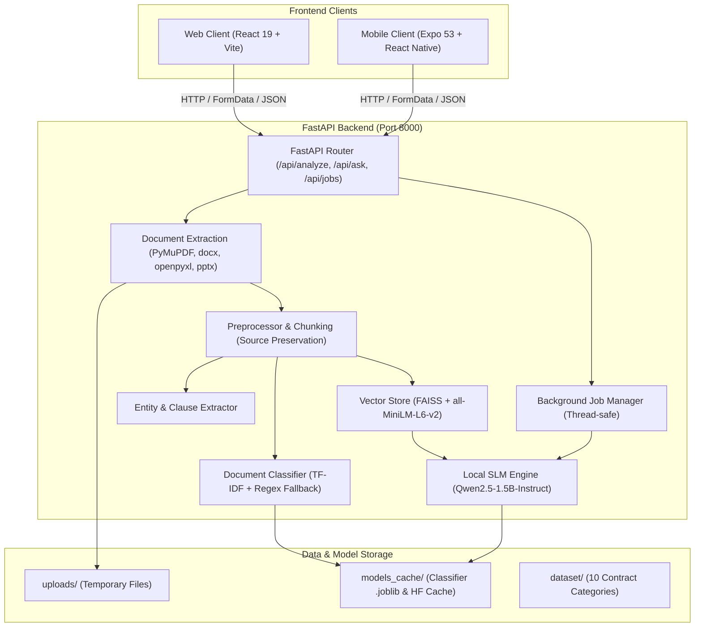

# LexiGuard AI: System Architecture & Project Context (`CONTEXT.md`)

> **CRITICAL INSTRUCTION FOR ALL AI ASSISTANTS / AGENTS:**
> 1. **READ BEFORE EDITING:** Before analyzing, modifying, or creating any files in this project, consult this file thoroughly. It contains the comprehensive system architecture, state flow, API contracts, design patterns, and operational guidelines. You do not need to re-read every individual file across the codebase on every task.
> 2. **MANDATORY UPDATE PROTOCOL:** If you add new features, endpoints, components, services, configuration flags, or modify existing functionality, you **MUST update this `CONTEXT.md` file** before concluding your task so that future AI agents always possess accurate, up-to-date context.

---

## 1. Project Overview & Mission

**LexiGuard AI** (AI-Powered Multi-Contract Analyzer) is an end-to-end document intelligence system designed for legal, business, and general documents. Built as an academic and production-ready prototype, it leverages an efficient Small Language Model (**Qwen2.5-1.5B-Instruct**) coupled with retrieval-augmented generation (**FAISS** + **SentenceTransformers**) to perform high-speed document extraction, classification, entity recognition, clause extraction, structured summarization, risk profiling, and grounded Q&A—all running locally on commodity CPU/GPU hardware.

### Key Capabilities
- **Multi-Format Extraction:** Seamlessly parses PDF (scanned & digital), DOCX, TXT, CSV, XLSX, PPTX, Markdown, and HTML.
- **Dual Pipeline (Sync & Async):** Supports direct synchronous responses for small files as well as non-blocking background worker jobs with real-time percentage progress heartbeats (`0%` to `100%`), sub-task stage reporting, and instant cancellation.
- **Hybrid Document Classification:** Combines scikit-learn TF-IDF Logistic Regression with regex pattern fallbacks to classify contracts (Lease, NDA, Employment, MSA, etc.) vs. non-contract documents (Financial, Technical, Presentation, Policy), including multilingual tenancy indicators (English, Marathi, Hindi).
- **Automated NLP & Relational Extraction:** Custom rule-based Named Entity Recognition (Parties, Dates, Monetary Amounts, Phone Numbers, Property identifiers, Durations, Emails) and clause detection with relational understanding between parties.
- **Grounded AI Generation:** Local SLM inference with strict prompt templates preventing hallucinations, citing page/section numbers, and acknowledging when queried information is absent from the document.
- **Cross-Platform User Interfaces:**
  - **Web Client:** Responsive desktop/tablet application built with React 19, TypeScript, Vite, custom design system, light/dark themes, animated live progress bar with percentage badge, and client-side history storage.
  - **Mobile Client:** Mobile application built with React Native 0.79 and Expo 53 with adaptive network routing (Web, Android Emulator, physical LAN device).

---

## 2. High-Level System Architecture



---

## 3. Repository Structure

```
AI-Contract-Analyzer-main/
├── .agents/                      # Workspace Agent Customizations & Skills
│   └── skills/
│       ├── ponytail/             # Lazy senior dev mode (minimal changes, YAGNI, high clarity)
│       ├── ponytail-audit/       # Audits codebase for bloat and dead code
│       ├── ponytail-debt/        # Identifies technical debt and unnecessary abstractions
│       ├── ponytail-gain/        # Assesses ROI and complexity vs. gain
│       ├── ponytail-help/        # Help and usage instructions for Ponytail suite
│       └── ponytail-review/      # Minimalist, high-signal code review
├── CONTEXT.md                    # THIS FILE: Master AI project context & instructions
├── README.md                     # Project quickstart and overview
├── generate_test_files.py        # Generates synthetic test fixtures (PDF, DOCX, CSV, etc.)
├── test_suite_all.py             # 11 comprehensive automated end-to-end integration tests
├── test_upload_integration.py    # Standalone upload integration test script
├── test_contract.pdf             # Sample PDF residential lease contract
├── test_contract.docx            # Sample DOCX commercial lease contract
├── test_contract.txt             # Sample plain text agreement
├── test_long_contract.txt        # Multi-page SaaS/MSA agreement fixture
├── test_tech_spec.md             # Non-contract technical spec fixture
├── test_financial.csv            # Non-contract financial CSV fixture
├── test_empty.txt                # 0-byte invalid file fixture
├── test_corrupt.pdf              # Corrupt PDF binary fixture
│
├── backend/                      # Python FastAPI Backend
│   ├── app.py                    # Server entrypoint, CORS, lifespan model pre-warming
│   ├── requirements.txt          # Python package dependencies
│   ├── .env.example              # Environment variables template
│   ├── uploads/                  # Temporary file upload directory (.gitkeep)
│   ├── models_cache/             # Serialized models and joblib artifacts (.gitkeep)
│   ├── routes/
│   │   ├── __init__.py
│   │   ├── analyze.py            # Upload, document analysis, job polling, format listing
│   │   └── ask.py                # Grounded Q&A endpoint (/api/ask)
│   ├── services/
│   │   ├── __init__.py
│   │   ├── document.py           # Multi-format document parsing (.pdf, .docx, .csv, etc.)
│   │   ├── preprocess.py         # Text cleaning and source-aware chunking
│   │   ├── classifier.py         # ML + rule-based contract & document classifier
│   │   ├── ner.py                # Regex-based Named Entity Recognition
│   │   ├── clauses.py            # Contract clause detection & mapping
│   │   ├── retrieval.py          # SentenceTransformer + FAISS semantic search
│   │   ├── slm.py                # HuggingFace Qwen2.5-1.5B loading & text generation
│   │   ├── jobs.py               # In-memory thread-safe background job registry
│   │   └── pipeline.py           # Analysis orchestration & structured output parsing
│   └── training/
│       └── train_classifier.py   # TF-IDF + Logistic Regression training script
│
├── dataset/                      # Contract category training text files
│   ├── README.md
│   ├── consent/                  # Informed consent agreements
│   ├── employment/               # Employment contracts
│   ├── freelance/                # Freelance and consulting contracts
│   ├── loan/                     # Loan agreements & promissory notes
│   ├── nda/                      # Non-disclosure agreements
│   ├── partnership/              # Partnership agreements
│   ├── privacy/                  # Privacy policies & terms of service
│   ├── rental/                   # Residential & commercial leases
│   ├── service/                  # Master service agreements (MSA)
│   └── vendor/                   # Vendor & supplier contracts
│
├── docs/
│   └── API.md                    # Quick API reference
│
├── model/
│   └── README.md                 # SLM configuration notes
│
├── web/                          # React 19 + TypeScript + Vite Web Application
│   ├── package.json              # Web dependencies (react 19, lucide-react, vite)
│   ├── vite.config.ts            # Vite configuration
│   ├── tsconfig.json             # TypeScript root config
│   ├── tsconfig.app.json         # TypeScript application config
│   ├── index.html                # Single-page HTML container
│   ├── public/                   # Static assets & icons
│   └── src/
│       ├── main.tsx              # React DOM mounting
│       ├── App.tsx               # App entrypoint and top-level layout router
│       ├── App.css               # Top-level styling
│       ├── index.css             # Base reset styling
│       ├── api/
│       │   ├── client.ts         # Fetch wrapper with timeout and AbortController
│       │   └── contractApi.ts    # API client methods (analyze, ask, jobs, health)
│       ├── context/
│       │   ├── ContractContext.tsx # Central application state & job poller
│       │   └── ThemeContext.tsx    # Light/Dark mode state provider
│       ├── types/
│       │   └── contract.ts       # Shared TypeScript types and interfaces
│       ├── styles/
│       │   ├── tokens.css        # Design tokens: CSS variables for colors, spacing, radius
│       │   └── index.css         # Component utility styles and themes
│       ├── components/
│       │   ├── Header.tsx        # Top navigation bar with status and theme toggle
│       │   ├── Sidebar.tsx       # Collapsible desktop sidebar navigation
│       │   ├── BottomNav.tsx     # Mobile-responsive bottom navigation bar
│       │   ├── BackendStatus.tsx # Connection indicator pill with ping check
│       │   ├── ThemeToggle.tsx   # Light / Dark mode toggle switch
│       │   ├── FileUploader.tsx  # Drag & drop upload area with format validation
│       │   ├── ProcessingSteps.tsx # Multi-stage animated stepper during analysis
│       │   ├── SummaryCard.tsx   # Executive summary presentation card
│       │   ├── RiskCard.tsx      # Risk analysis & attention points card
│       │   ├── EntityCard.tsx    # Extracted entities display (parties, dates, money)
│       │   ├── ClauseCard.tsx    # Detected legal clauses accordion/badges
│       │   ├── SourceSection.tsx # Document source citations reference
│       │   ├── ChatInput.tsx     # Question input bar with auto-suggestions
│       │   ├── ChatMessage.tsx   # Chat bubble with source citation tags
│       │   ├── DocumentPreviewModal.tsx # Full clean-text document preview modal
│       │   └── EmptyState.tsx    # Reusable zero-data placeholder component
│       └── views/
│           ├── HomeView.tsx      # Landing page with hero, features, and upload trigger
│           ├── DashboardView.tsx # Analytics dashboard with upload history metrics
│           ├── UploadView.tsx    # Dedicated file upload and configuration view
│           ├── ProcessingView.tsx# Active progress view with cancel button
│           ├── AnalysisView.tsx  # Main contract analysis dashboard (tabbed)
│           ├── AskAiView.tsx     # Interactive chat interface for contract Q&A
│           ├── MyContractsView.tsx# Historical contracts list with search and deletion
│           └── SettingsView.tsx  # API URL, model parameters, and local data reset
│
└── mobile/                       # React Native + Expo Mobile Application
    ├── package.json              # Mobile dependencies (expo 53, react-native 0.79)
    ├── app.json                  # Expo project manifest
    ├── App.tsx                   # Mobile entrypoint & provider tree
    └── src/
        ├── config.ts             # Host IP & dynamic platform API URL resolver
        ├── firebaseConfig.ts     # Firebase client setup (Auth/Firestore/Storage)
        ├── api/
        │   └── contractApi.ts    # Mobile HTTP client for FastAPI backend
        ├── context/
        │   └── ContractContext.tsx # Mobile state provider (active doc, history, chat)
        ├── theme/
        │   └── colors.ts         # Mobile light & dark theme color palettes
        ├── types/
        │   └── contract.ts       # Mobile TypeScript types matching backend schemas
        ├── components/
        │   ├── TopBar.tsx        # Mobile navigation header
        │   ├── BottomNav.tsx     # Mobile bottom tab navigation bar
        │   └── CitationAccordion.tsx # Collapsible source citation viewer
        └── screens/
            ├── HomeScreen.tsx    # Mobile landing screen
            ├── UploadScreen.tsx  # Document picker & upload screen
            ├── AnalysisScreen.tsx# Analysis results viewer (Summary, Risk, Entities)
            ├── AskAiScreen.tsx   # Chat screen for document-grounded questions
            ├── ContractsScreen.tsx# Saved contracts history screen
            └── SettingsScreen.tsx# Backend IP settings & theme configuration
```

---

## 4. Backend Architecture & API Contracts

### 4.1 Server Configuration & Lifespan (`backend/app.py`)
- **Port / Host:** Default runs on `http://127.0.0.1:8000`.
- **CORS:** Enabled for all origins (`*`) with credentials support.
- **Model Warmup (Lifespan):** On startup, `warmup_slm()` and `get_embedder()` are launched asynchronously in background worker threads so that the first user request incurs zero cold-start delay.
- **Environment Variables (`backend/.env`):**
  - `SLM_MODEL`: Hugging Face model identifier (Default: `Qwen/Qwen2.5-1.5B-Instruct`).
  - `EMBEDDING_MODEL`: Sentence transformer model (Default: `sentence-transformers/all-MiniLM-L6-v2`).
  - `MAX_NEW_TOKENS`: Generation token ceiling (Default: `350`).
  - `TOP_K`: Number of retrieval chunks for Q&A (Default: `3`).
  - `TORCH_THREADS`: CPU thread count for PyTorch (Default: `min(8, max(2, cpu_count))`).

### 4.2 Endpoints Specification

#### `GET /`
- **Description:** Health check and API service information.
- **Response:**
  ```json
  {
    "message": "AI Contract Analyzer API (LexiGuard AI) is running",
    "docs": "/docs",
    "status": "ready"
  }
  ```

#### `GET /api/supported-formats`
- **Description:** Returns the list of document file extensions supported by the extraction service.
- **Response:**
  ```json
  {
    "supported_extensions": [".csv", ".docx", ".htm", ".html", ".md", ".pdf", ".pptx", ".txt", ".xlsx"]
  }
  ```

#### `POST /api/analyze`
- **Description:** Uploads and analyzes a document file. Cleans up temporary uploaded files automatically via `finally: path.unlink(missing_ok=True)` in both sync and async worker execution.
- **Query Params:**
  - `async_mode` (*bool*, default: `false`): If `true`, creates a background job and returns immediately with a `job_id`.
- **Form Data:**
  - `file`: Multipart file binary (must match supported extensions and be > 0 bytes).
- **Synchronous Response (`async_mode=false`):** Full `AnalysisResult` JSON object (described in Section 4.3).
- **Asynchronous Response (`async_mode=true`):**
  ```json
  {
    "job_id": "c1f7b029-...",
    "status": "processing",
    "stage": "Extracting text and structure...",
    "filename": "lease_agreement.pdf"
  }
  ```

#### `GET /api/jobs/{job_id}`
- **Description:** Polls the status and progress of a background analysis job.
- **Response:**
  ```json
  {
    "job_id": "c1f7b029-...",
    "filename": "lease_agreement.pdf",
    "status": "processing | completed | failed | cancelled",
    "stage": "Running LexiGuard AI reasoning with Qwen2.5-1.5B...",
    "progress": 55,
    "result": null,  // Becomes AnalysisResult when status == "completed"
    "error": null
  }
  ```

#### `POST /api/jobs/{job_id}/cancel`
- **Description:** Requests cooperative cancellation of an active background job.
- **Response:**
  ```json
  {
    "job_id": "c1f7b029-...",
    "status": "cancelled",
    "message": "Job cancellation requested."
  }
  ```

#### `POST /api/ask`
- **Description:** Answers a document-grounded question based on the document text. Enforces `max_length=500000` on `contract_text` and `max_length=2000` on `question`.
- **Request Body:**
  ```json
  {
    "contract_text": "Full document or clean extracted text (max 500k chars)...",
    "question": "What is the monthly rent and payment due date? (max 2k chars)",
    "conversation_history": [
      {"sender": "user", "text": "Who is the landlord?"},
      {"sender": "ai", "text": "The landlord is John Smith."}
    ],
    "file_id": "optional-uuid"
  }
  ```
- **Response:**
  ```json
  {
    "question": "What is the monthly rent and payment due date?",
    "answer": "Direct Answer: The monthly rent is $1,500 due on the first day of each month [Page 1].",
    "retrieved_sections": [
      "[Page 1]: Monthly rent shall be $1,500 due on the 1st day of each calendar month..."
    ]
  }
  ```

### 4.3 `AnalysisResult` Data Schema
```typescript
interface AnalysisResult {
  file_id?: string;
  filename?: string;
  contract_type: {
    contract_type: string;
    confidence: number;
  };
  is_contract: boolean;
  category: string;
  entities: {
    parties: string[];
    dates: string[];
    money: string[];
    durations: string[];
    emails: string[];
  };
  clauses: Record<string, {
    detected: boolean;
    present: boolean;
    matched_terms: string[];
  }>;
  chunk_count: number;
  summary: string;
  risk_analysis: string;
  document_overview: string;
  executive_summary: string;
  key_points: string;
  important_details: string;
  document_specific_analysis: string;
  source_references: string[];
  limitations: string;
  clean_text: string;
  metrics: {
    extract_sec: number;
    nlp_sec: number;
    inference_sec: number;
    total_sec: number;
  };
  from_cache?: boolean;
}
```

---

## 5. Backend Services Breakdown

### 5.1 `services/document.py`
- Handles multi-format ingestion:
  - **PDF (`extract_pdf_data`):** Uses PyMuPDF (`pymupdf`). Extracts per-page text with `[Page X]` source tags. Detects scanned pages (low character count with image presence) and injects an OCR limitation warning notice.
  - **DOCX (`extract_docx_data`):** Uses `python-docx`. Extracts heading structures and table cell content.
  - **TXT / MD (`extract_txt_data`, `extract_markdown_data`):** Multi-encoding auto-detection (`utf-8`, `utf-8-sig`, `utf-16`, `latin-1`, `cp1252`).
  - **CSV / XLSX (`extract_csv_data`, `extract_xlsx_data`):** Formats rows into clean tabular strings, capped at 500 rows for memory efficiency.
  - **PPTX (`extract_pptx_data`):** Extracts slide-by-slide text with `[Slide X]` source attribution, including text within shape tables (`shape.has_table`).
  - **HTML (`extract_html_data`):** Uses a clean subclass of `html.parser.HTMLParser` to strip scripts/styles while maintaining paragraph structure.

### 5.2 `services/preprocess.py`
- `clean_text(text)`: Eliminates null bytes, collapses multiple whitespace/tabs, and limits consecutive newlines.
- `chunk_text(text, max_chars=1500, overlap=200)`: Paragraph-preserving sliding window chunker.
- `chunk_document_with_sources(doc_data)`: Preserves metadata headers such as `Page 1`, `Section 2`, or `Slide 3` for every chunk so retrieval citations always map to human-identifiable locations.

### 5.3 `services/classifier.py`
- **Classifiers Supported:**
  1. *Residential Lease Agreement*
  2. *Commercial Lease Agreement*
  3. *Non-Disclosure Agreement (NDA)*
  4. *Employment Agreement*
  5. *Master Services Agreement (MSA)*
  6. *Consulting Agreement*
  7. *Vendor & Supplier Contract*
  8. *Loan & Financing Agreement*
  9. *Partnership Agreement*
  10. *Non-Contract Documents:* Financial Reports, Technical Specs, Presentation Decks, Policies.
- **Inference Hierarchy:**
  1. Attempts prediction via trained scikit-learn model (`models_cache/contract_classifier.joblib`).
  2. If absent or low-confidence, applies comprehensive regex keyword heuristics with confidence calculation based on match density.

### 5.4 `services/ner.py` & `services/clauses.py`
- **NER:** Regex pattern extraction for dates, monetary values (USD, INR, EUR, etc.), durations, email addresses, and party names (extracts names following "between [A] and [B]" and role prefixes like "Landlord:").
- **Clauses:** Scans for 9 core legal categories: `termination`, `payment`, `confidentiality`, `liability`, `renewal`, `governing_law`, `intellectual_property`, `non_compete`, `data_privacy`.

### 5.5 `services/retrieval.py`
- Uses `SentenceTransformer("sentence-transformers/all-MiniLM-L6-v2")` cached via `@lru_cache`.
- Creates normalized embeddings and queries FAISS `IndexFlatIP` (Cosine similarity).
- Incorporates keyword match bonus (+0.15 score per matching keyword).
- Implements an LRU document index cache holding up to 20 active document embeddings to avoid re-embedding on multi-turn conversations.

### 5.6 `services/slm.py`
- Loads `Qwen/Qwen2.5-1.5B-Instruct` locally using HuggingFace `transformers`.
- Uses `bfloat16` or `float32` on CPU with `torch.set_num_threads()` tuned to avoid core contention.
- Implements `_INFERENCE_LOCK` (`threading.Lock()`) to guarantee sequential CPU inference without memory thrashing.
- Handles context window truncation (>3200 tokens) by preserving the prompt beginning and end.

### 5.7 `services/pipeline.py`
- Combines document extraction, classification, NER, clause detection, and SLM generation.
- Utilizes a single-pass prompt to generate:
  - `### Executive Summary`
  - `### Key Points & Obligations`
  - `### Important Details`
  - `### Risk & Attention Points` (or `Document-Specific Insights`)
- Parses these markdown sections via `parse_structured_analysis()` into discrete payload fields for UI components.
- Caches analysis results by document SHA-256 hash.
- Implements `answer_question()` with strict anti-hallucination rules, prompt injection defenses, and conversation history support.

### 5.8 `services/jobs.py`
- Thread-safe in-memory store for tracking asynchronous processing jobs (`pending`, `processing`, `completed`, `failed`, `cancelled`).
- Supports cancellation checks at key pipeline milestones (`is_job_cancelled`).
- Automatically evicts jobs older than 1 hour on each `create_job()` call to prevent memory leaks.

---

## 6. Web Application Architecture (`web/`)

### 6.1 State Management & Architecture
- **Framework:** React 19 + TypeScript + Vite.
- **Design System:** Custom CSS token system in `tokens.css` with semantic color palettes, border radiuses, shadows, and smooth transitions.
- **Theme Support:** `ThemeContext.tsx` toggles between `'light'` and `'dark'` mode by applying the `data-theme` attribute to `document.documentElement` and persisting in `localStorage`.
- **Core State (`ContractContext.tsx`):**
  - `currentView`: Navigation state (`home`, `dashboard`, `upload`, `processing`, `analysis`, `ask_ai`, `my_contracts`, `settings`).
  - `activeContract`: The currently selected or analyzed document result.
  - `contractHistory`: Saved list of previous analyses persisted in browser `localStorage`.
  - `backendStatus`: Real-time backend status (`connected`, `checking`, `offline`).
  - `chatMessages`: Active chat history for the grounded Q&A tab.
  - `startAnalysis(file)`: Coordinates asynchronous job dispatch, polling loop with 1.5s interval, step advancement, and graceful error handling with `AbortController`.

### 6.2 Views Breakdown
1. **`HomeView`:** Clean landing page highlighting product capabilities, recent contract shortcuts, and a prominent upload call-to-action.
2. **`DashboardView`:** Analytical overview of parsed contracts, risk distributions, recent activity cards, and storage consumption.
3. **`UploadView`:** Interactive drag & drop zone supporting all 9 formats with format pills, file size checks, and instant launch into the processing view.
4. **`ProcessingView`:** Animated 5-step progress stepper displaying current pipeline stage, elapsed time, and a functional cancellation button.
5. **`AnalysisView`:** Tabbed result interface:
   - *Overview Tab:* Executive Summary card, Document Overview, Key Points, Risk Alert card.
   - *Clauses Tab:* Badges and details for detected legal clauses.
   - *Entities Tab:* Extracted parties, dates, financial amounts, durations, emails.
   - *Document Preview:* Clean text view modal with copy and export features.
6. **`AskAiView`:** Conversational chat interface grounded strictly in the active document. Displays question suggestions, response text, and clickable citation tags.
7. **`MyContractsView`:** Searchable, filterable list of all previously analyzed documents stored in `localStorage`. Allows switching the active document or deleting items.
8. **`SettingsView`:** Allows customizing the backend API URL (e.g. for connecting to remote or local IP), viewing model parameters, and clearing local history.

---

## 7. Mobile Application Architecture (`mobile/`)

### 7.1 Cross-Platform Mobile Setup
- **Framework:** React Native 0.79 + Expo 53.
- **Dynamic Network Resolution (`mobile/src/config.ts`):**
  - Web: `http://127.0.0.1:8000`
  - Android Emulator: `http://10.0.2.2:8000`
  - iOS Simulator: `http://127.0.0.1:8000`
  - Physical Mobile Device: Resolves automatically to the development machine's local LAN IP (`http://192.168.2.103:8000`).
- **File Upload:** Uses `expo-document-picker` to select documents from mobile storage and sends multipart requests to `/api/analyze`.
- **Screens:** Mirrored after web functionality (`HomeScreen`, `UploadScreen`, `AnalysisScreen`, `AskAiScreen`, `ContractsScreen`, `SettingsScreen`).

---

## 8. Verification & Test Suite

The project includes a comprehensive test suite in `test_suite_all.py` validating 11 critical integration flows:

| Test ID | Test Name | Target Behavior |
| :--- | :--- | :--- |
| **Test 1** | Small PDF Contract | Async job upload, polling, text extraction, Qwen summary generation |
| **Test 2** | DOCX Contract | Heading hierarchy, table extraction, entity detection |
| **Test 3** | TXT Contract | Plain text encoding robustness, executive summary format |
| **Test 4** | Long SaaS Agreement | Multi-chunk extraction, paragraph overlap, clause risk analysis |
| **Test 5** | Non-Contract Tech Spec | Correct identification as non-contract (`is_contract=False`) |
| **Test 6** | 0-Byte Empty File | Rejection with HTTP 400 and informative error message |
| **Test 7** | Corrupted PDF File | Corrupted binary rejection with HTTP 400 |
| **Test 8** | Grounded QA (Answer Present) | Correct factual retrieval and citation of rent amount ($1,500) |
| **Test 9** | Grounded QA (Answer Absent) | Explicit refusal to hallucinate; states topic is not in document |
| **Test 10** | Multi-Turn Conversational QA | Context-aware follow-up question using conversation history |
| **Test 11** | Background Job Cancellation | Immediate cancellation of running background job via API |

---

## 9. Development & Operations Guide

### 9.1 Backend Setup & Execution
```powershell
cd backend
python -m venv .venv
.venv\Scripts\activate
pip install -r requirements.txt
uvicorn app:app --host 0.0.0.0 --port 8000 --reload
```
- Swagger API Docs: `http://127.0.0.1:8000/docs`

### 9.2 Web Frontend Setup & Execution
```powershell
cd web
npm install
npm run dev
```
- Web Application: `http://localhost:5173`

### 9.3 Mobile App Setup & Execution
```powershell
cd mobile
npm install
npx expo start
```

### 9.4 Running the Test Suite
Ensure the backend is running on `http://127.0.0.1:8000`, then execute:
```powershell
python test_suite_all.py
```

---

## 10. Rules & Invariants for Future AI Modifications

When modifying or extending this codebase, **every AI assistant MUST adhere to the following invariants**:

1. **Keep Grounding Strict:** In `services/pipeline.py` and `services/slm.py`, never alter prompts to allow speculative or unverified factual claims. The model must refuse to answer questions about topics not present in the supplied document text.
2. **Thread Safety in Local SLM:** The Hugging Face model inference in `services/slm.py` is protected by `_INFERENCE_LOCK`. Do not remove this lock, as parallel forward passes on CPU will cause excessive memory usage and severe CPU cache degradation.
3. **Preserve Source Citations:** Whenever modifying chunking (`services/preprocess.py`) or extraction (`services/document.py`), preserve page/section/slide source identifiers. The QA engine relies on `[Page X]` or `[Section Y]` tags for citations.
4. **Synchronous & Asynchronous Compatibility:** Any changes to the analysis pipeline must maintain compatibility with both synchronous (`async_mode=false`) and asynchronous background job polling (`async_mode=true`).
5. **Format Validation:** If adding a new document format, register the extension in `SUPPORTED_EXTENSIONS` in `services/document.py` and implement the corresponding parsing logic with error handling.
6. **Keep `CONTEXT.md` Updated:** When adding endpoints, modifying state models, or changing UI components, make sure to document those changes in this file before finishing.
